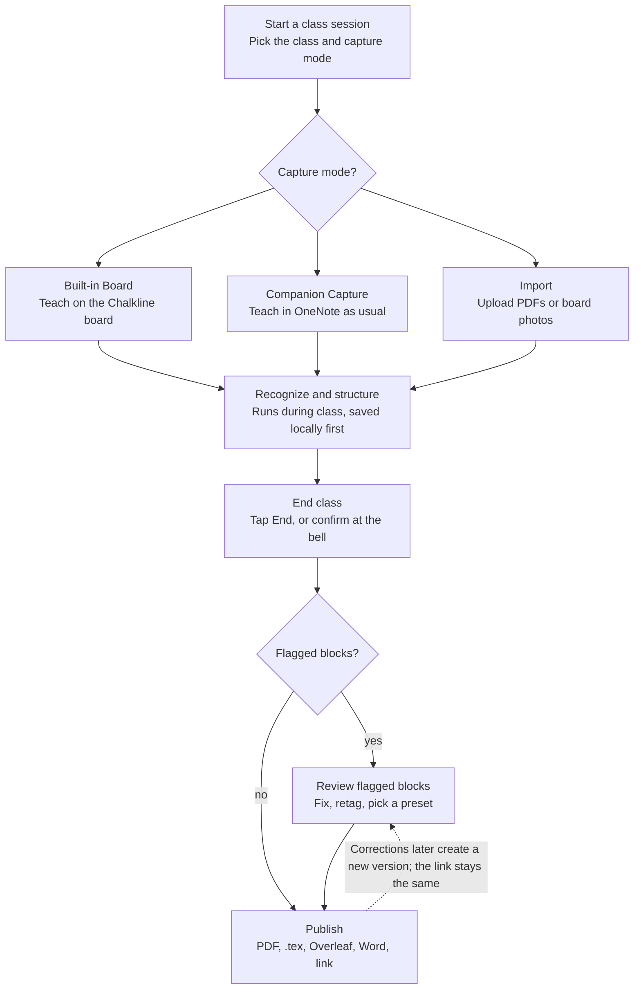
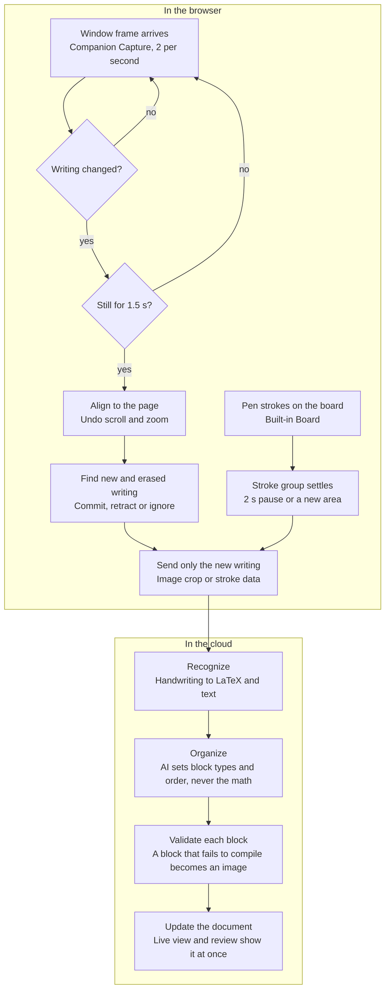
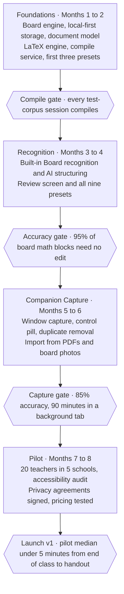

# Chalkline — Product Design Document

October 20, 2026

## Overview

Chalkline turns what a teacher writes on the board during class into a clean, typeset LaTeX handout (notes, practice worksheet and answer key) that is ready to share within five minutes of the bell.

**The problem.** Math teachers do the work twice: once live on the board, and again at night retyping it. More often it never gets retyped, and students get a phone photo of a crowded board. LaTeX is the standard for readable math, but authoring it by hand is far too slow for daily lessons.

**The product.** A web app for Edge and Chrome on Windows, installable as a desktop app (PWA). It captures in two ways:

- **Built-in Board**, a smartboard whiteboard inside Chalkline that records ink strokes directly. This gives the best recognition.
- **Companion Capture**, which watches a OneNote, Microsoft Whiteboard or panel-software window through the browser's screen-share and recognizes new writing as it settles. Teachers keep the tools they already know.

Recognized content becomes a structured document model, not raw LaTeX. Presets render that model as Lecture Notes, Worksheet, Answer Key and more. After class, a short review fixes anything flagged, then the teacher publishes a PDF, .tex source, Word file or an Overleaf project.

**The promise: teach normally, leave with the handout.** Three commitments shape every decision in this document:

1. **No added work during class.** Capture is invisible and tagging is optional. Optional quick tags only improve the result.
2. **Never lose content, never invent it.** Anything that can't be recognized confidently is kept as a cropped image and flagged. AI may organize content, but it never changes math without showing the change.
3. **The output always compiles.** Every block is validated on its own. A bad block falls back to an image; it never breaks the document.

"Chalkline" is a working name and needs a trademark check before launch.

## Users, goals and non-goals

Version 1 is built for the math teacher at an interactive flat panel; everyone else is served by the same flow without special features.

| Who | What they need | How v1 answers |
| --- | --- | --- |
| Math teacher, grades 6 to college (primary) | Typeset notes, practice and keys without retyping after class | Automatic capture, math-first recognition, one-click "notes + worksheet + key" set |
| Science teacher (secondary) | Equations, units and diagrams kept accurate | Units convention (siunitx), diagrams kept as crisp images, chemistry in v2 |
| Any-subject teacher (secondary) | Clean notes from mostly handwritten text | Handwriting text recognition, prose-heavy Lecture Notes preset |
| Department head or school IT admin | Approved privacy terms, managed accounts, house style | School workspace, SSO, locked school presets with logo and header |
| Student (reader only) | A readable, accessible handout | Share links, tagged PDF, accessible HTML view; no student accounts in v1 |

The target setup is a Windows PC driving an interactive flat panel (SMART, Promethean, ViewSonic, Clevertouch and similar) by HDMI and USB touch, running Edge or Chrome. Many teachers also run the panel in duplicate mode with a laptop.

### Goals for v1

- **Speed:** median time from "End class" to a shared PDF is under 5 minutes, review included.
- **Accuracy:** on the internal test corpus, at least 95% of math blocks from the Built-in Board need no edit, and at least 85% from Companion Capture.
- **Reliability:** 100% of generated documents compile, and no captured content is ever lost, including after a crash or network drop.
- **Fit:** runs on school-managed Windows PCs with nothing to install beyond the browser.
- **Privacy by design:** teacher-only accounts, minimal data kept, school data agreements ready at launch.

### Non-goals for v1

- A native Windows app or browser extension (the web platform covers the need; revisit if Companion Capture hits browser limits).
- Student accounts, live student viewing or real-time co-editing.
- Audio or lecture transcription (strong v2 candidate).
- Grading or gradebook sync.
- Converting hand-drawn diagrams to TikZ from screen capture (they ship as images; Built-in Board diagrams ship as vector drawings).
- Recognition while offline (capture keeps working offline; recognition waits for the connection).

## Product experience

Everything a teacher does is organized around one **class session**: start it, teach, end it, review, publish. Three capture modes feed the same session.

### Capture modes

| Mode | How it captures | Best for | Expected fidelity |
| --- | --- | --- | --- |
| Built-in Board | Ink strokes with timing and pressure, straight from Chalkline's own canvas | Teachers ready to switch, new adopters, best results | Highest: strokes, exact erasures, typed math and plotted graphs are exact |
| Companion Capture | Screen-share of one app window (OneNote, Microsoft Whiteboard, panel software), analyzed frame by frame in the browser | Teachers who keep their current tools | Good: depends on legibility and zoom level |
| Import | Upload PDFs, images or board photos; OneNote pages through Microsoft Graph arrive in v1.1 | Catching up after class, absent-day handouts | Good: same pipeline, no timing data |

### Session lifecycle

A session moves through six states: **Ready, Capturing, Paused, Ended, In review, Published.** It can return from Published to In review for corrections, which creates a new published version and keeps the old link working.

1. **Start.** The teacher picks a class and the capture mode. The preset defaults to the class's preset. Header fields fill themselves: course, teacher, date and a lesson title the teacher can edit later. Starting takes two taps from the home screen.
2. **Teach.**
    - *Built-in Board:* the board goes full-screen. A small status dot shows green (capturing), amber (saved locally, waiting for network) or red (stopped).
    - *Companion Capture:* the teacher picks the window once in the browser's share dialog. Chalkline then opens a small always-on-top control pill (a Document Picture-in-Picture window) with Pause, Mark, Exclude last and the status dot. The teacher switches to OneNote and teaches as usual.
3. **Optional quick tags.** Never required, always helpful: *New section, New problem, Solution, Key result, Exclude.* They're on the pill, on the board toolbar, in the lasso menu and on keyboard shortcuts. Untagged content is structured automatically.
4. **Optional live view.** On a second screen or the teacher's laptop, the document can be watched as it assembles. It is off by default so nothing distracts from teaching.
5. **End.** The teacher taps End. Chalkline also offers to end after 20 minutes without new content, or at the period's end time when a bell schedule is set, always with a confirmation and never silently. Final processing typically finishes within 60 seconds.
6. **Review and publish.** See the Review section. Teachers with zero flagged blocks can publish straight away.

### Teaching the same lesson more than once

Teachers often deliver one lesson to three periods. A new session can **continue** an earlier one, so new content merges into the same document, or **reuse** it, skipping capture and attaching the existing handout to the new class. Merging never duplicates a problem that already exists; it is matched by its recognized content.

## Whiteboard features

The Built-in Board is designed for a 65 to 86 inch touch panel, used standing, at arm's length, by someone who is also talking to 30 students. Anything a teacher draws with a math tool comes out exact, not recognized.

### Drawing and editing

| Tool | v1 behavior |
| --- | --- |
| Pen | Pressure-aware, 3 widths, 8-color high-contrast palette (black, blue, red, green, orange, purple, brown, white on dark theme) |
| Highlighter | Translucent, drawn under ink; excluded from recognition, kept as emphasis when the preset allows color |
| Eraser | Stroke eraser by default, area eraser on long-press; a palm-sized contact erases automatically |
| Lasso | Select, move, resize, recolor, duplicate, delete, or tag the selection (Problem, Solution, Key result, Exclude) |
| Shapes | Hold the pen still for half a second at the end of a stroke to snap it to a line, arrow, circle, ellipse, rectangle or triangle |
| Text box | Keyboard text for typed notes |
| Math box | Typed math with a visual equation editor; its LaTeX is exact |
| Undo and redo | Toolbar buttons and a two-finger tap for undo; unlimited history per session |
| Laser pointer | Fading trail for pointing; never recorded |
| Pages and canvas | Infinite canvas within each page, any number of pages, page sorter, page duplicate |

### Math tools

These produce exact output, so they skip recognition entirely.

- **Function plotter:** type `y = x^2 - 3`, set the window, and an exact graph appears. It exports as a pgfplots figure.
- **Coordinate plane and number line:** inserts with configurable ranges and tick spacing; points and segments drawn on them snap to the grid.
- **Table:** rows and columns of handwritten or typed cells, exported as a LaTeX table.
- **Ruler:** draggable straightedge for clean lines. Protractor and compass arrive in v1.1.
- **Backgrounds:** blank, grid, dot, lined, graph paper, coordinate grid, plus a dark "chalkboard" theme. Recognition handles both light and dark backgrounds.

### Import onto the board

A PDF or image can be placed as a page background, for example a worksheet to annotate or a textbook figure. Writing on top of it is recognized. The background itself is included as an image or left out, depending on the preset.

### Smartboard-specific design

- **Reach:** the toolbar docks at the bottom by default so shorter teachers and wheelchair users can reach it. It can dock left or right, and mirrors for left-handed use. Touch targets are at least 56 px.
- **No hidden interactions:** nothing depends on hover or right-click, and long-press never does anything destructive.
- **Browser gestures off on the canvas:** no page pinch-zoom, swipe-back navigation, pull-to-refresh, text selection or context menu while drawing.
- **Pen versus finger:** many panels report their pens as plain touch. *Panel mode* (the default) treats one contact as drawing, two fingers as pan and zoom, and a palm-sized contact as erase. *Pen mode*, for devices with an active pen, draws with the pen and pans with fingers. The board detects which one fits during the first minute and suggests a switch.
- **Two writers at once:** two separate single-finger contacts draw two independent strokes, so two students can work at the board. Two fingers close together and moving together are read as a pan or zoom.
- **Low latency:** ink should appear within 25 ms of the pen moving, measured on a 4K panel driven by a typical school PC.
- **Never lose a stroke:** every stroke is saved locally the moment it ends, so a crash, refresh or power loss costs nothing.
- **Board export:** the raw board itself can be exported as a PDF of pages, separate from the typeset document.

## Document presets and conventions

A preset combines three things: a **template** (how it looks), **structure rules** (which content goes in, in what order) and **conventions** (how math and text are written). Any session can be rendered with any preset at any time. Switching presets never re-runs recognition, so it is instant and free.

### Built-in presets

| Preset | What it includes | Typical use |
| --- | --- | --- |
| Lecture Notes | Everything not excluded; definitions and theorems boxed; examples with full solutions | The day's notes for students |
| Guided Notes | Lecture Notes with key results and selected steps replaced by blanks; a filled version is generated alongside | Fill-in notes for the next class or for absent students |
| Worked Examples | Problems with full solutions, nothing else | Homework help, reteaching |
| Practice Worksheet | Problems only, numbered, with answer space sized from the length of the original solution | Practice and homework |
| Answer Key | Problems with final answers, or full solutions (toggle) | Companion to the worksheet |
| Quiz | Worksheet plus name, date and score header, optional point values, never a page break inside a problem | Quick assessments |
| Study Sheet | Definitions, theorems and formulas only, compact two-column layout | Review before a test |
| Exit Ticket | The last one to three problems, half-page, two per sheet | End-of-class check |
| Board Snapshot | Everything in board order with minimal restructuring | Faithful record of the board |

**Make the set:** one button produces Lecture Notes, Practice Worksheet and Answer Key from the same session, the most common need.

### Conventions

Conventions can be set per preset, per class or for the whole school. The most specific setting wins, and a school can lock a setting.

| Convention | Options | Default |
| --- | --- | --- |
| Paper size | US Letter, A4 | From the school's country |
| Type | Latin Modern, TeX Gyre Pagella, TeX Gyre Termes, a sans-serif reading font; 10, 11, 12 pt; large print at 14 pt | Latin Modern 11 pt |
| Header and footer | Course, teacher, date, unit, lesson title, page x of y, school logo | Course, date, page numbers |
| Problem numbering | 1, 2, 3 with parts (a), (b); continue across sections or restart | Continuous |
| Equation numbers | None, all display equations, or only referenced ones | None |
| Multiplication sign | As written, centered dot, times sign | As written |
| Decimal separator | Point, comma | From the school's country |
| Vectors | Arrow, bold, as written | As written |
| Derivatives | As written, prime, Leibniz | As written |
| Differential d | Italic, upright | Italic |
| Final answers | Boxed or plain | Boxed |
| Ink color | Monochrome, or keep teacher colors for emphasis | Keep colors |
| Units | Plain text, consistent spacing via siunitx | siunitx |
| Language | English, Spanish, French, German, Portuguese (hyphenation and labels such as "Example" or "Ejemplo") | Teacher's language |

In v0.1, hyphenation for languages other than English is switched off until babel's per-language tagging support is verified; labels and dates are localized for all five languages.

**Conventions never change meaning.** They are applied to the parsed math, not by find-and-replace. A rule is only applied where its target is unambiguous: "bold vectors" changes a symbol only if it was written with an arrow or recognized as a vector. Where the engine is unsure, it lists a suggestion in review instead of applying it.

### School and custom presets

Schools can publish locked presets with their logo, header and house style. Teachers clone any preset to customize it. Advanced users can edit the LaTeX preamble directly, limited to an allowlist of safe packages; every edit is test-compiled before it can be saved.

## Review and publish

Review is where trust is earned: the teacher sees exactly what was captured next to what will be published, and fixes only what is flagged. The median review should take under 2 minutes.

### The review screen

- **Side by side:** the original ink or screen crop on the left, the typeset preview on the right, scrolled together. Clicking either side highlights its partner.
- **Block status:** every block shows *Ready*, *Check* (low confidence, amber), *Image* (kept as a picture because recognition failed, red) or *Excluded* (grey). A **Next issue** button walks through flagged blocks only.
- **Fixing a block:** click it to open a visual equation editor with a LaTeX source toggle. Text is edited in place. Every change shows the before and after.
- **Fixing structure:** change a block's type (problem, solution, note, definition, theorem, example, figure, announcement), merge or split blocks, drag to reorder, include or exclude, and re-run recognition on a block with a tighter crop.
- **AI changes are visible:** any reordering or convention applied by the engine is marked, and one click reverts it.
- **Outline panel:** sections and problems as a tree for fast navigation on long lessons.
- **Preset switcher:** the preview updates instantly as an HTML render. The PDF compiles in the background, with a "PDF ready" indicator.
- **History:** every edit is versioned, and any earlier version can be restored.

If no block is flagged, **Publish** is available directly from the end-of-class screen without opening review.

### Publish targets in v1

| Target | Notes |
| --- | --- |
| PDF | Tagged for screen readers (PDF/UA-2) where the preset supports it |
| LaTeX source (.tex) | Readable, commented, compiles on its own with a standard TeX Live |
| Project archive (.zip) | .tex, images and figure files, ready for any LaTeX editor |
| Open in Overleaf | Sends the project archive to a new Overleaf project |
| Word (.docx) | Equations as native Word equations |
| Share link | View-only web page with accessible math and a PDF download; revocable, optional expiry, hidden from search engines |
| Google Drive and OneDrive | Save the PDF and source to a chosen folder after the teacher connects the account |

### Library

Published and draft sessions are organized by class and unit, searchable by their recognized text. Next school year, a teacher duplicates a class's library and edits from there instead of starting over.

## Flowcharts

The teacher sees two decisions in a whole lesson: which capture mode to use, and whether anything needs review.

### End-to-end teacher flow

All three modes converge on one document model, so review, presets and publishing work identically whichever way content came in.

### Live capture loop

Nothing is sent while the teacher is still writing, which keeps recognition cost down and stops half-written lines from appearing; screen frames themselves never leave the browser.

## Edge cases and required v1 behavior

Each row below is a release requirement with an automated or scripted test. The rule behind all of them: keep capturing, never lose content, and tell the teacher only what they need to act on.

### Capture and classroom environment

| Situation | Required behavior |
| --- | --- |
| Teacher closes or reloads the Chalkline tab during class | Browser asks to confirm leaving. Everything captured is already saved locally. On reopening, a "Resume session" banner appears; Companion Capture asks the teacher to pick the window again (browsers require this) |
| Teacher clicks the browser's "Stop sharing" bar | Detected within 1 second. The pill turns red with a one-tap "Resume capture". Content captured so far is safe |
| Captured window is minimized | Frozen or blank frames are detected and analysis pauses. The pill shows amber with "OneNote is minimized" and resumes on its own when frames return |
| Screen saver, display sleep or PC lock | Same as minimized: pause, show amber, resume automatically |
| Wrong window shared (for example, email) | The pill shows a live thumbnail for the first 5 seconds. If the first frames look like an app interface rather than a writing surface, Chalkline asks to confirm before analyzing |
| Teacher switches OneNote page or section, then comes back | A page switch starts a new page. Returning is recognized by the page's fingerprint and continues the earlier page, without duplicates |
| Teacher scrolls or zooms in the captured app | Frames are aligned to page coordinates, so content seen again at a new position or zoom is matched, not duplicated. If alignment fails, duplicates are removed by content |
| Menus, pop-ups, ink toolbars or the mouse cursor in the captured window | A one-time crop excludes the app's toolbars. Overlays that appear briefly are ignored. Interface text that slips through is filtered during structuring |
| Dark board background with light ink | Detected and normalized before recognition |
| Chalkline tab in the background for the whole lesson | Frame analysis runs in a background worker driven by incoming frames, not timers. A watchdog raises a warning if frames stop arriving. This is a launch gate tested for 90 minutes on Edge and Chrome |
| Browser lacks screen capture of a single window (Firefox, Safari) | Built-in Board works in all modern browsers. Companion Capture shows a clear "Use Edge or Chrome" message |
| Panel reports pen input as touch | Panel mode handles it (see Whiteboard features) |
| Very long session (3 hours, 80 pages) | Strokes are paged to local storage, and frames are discarded after analysis, so memory stays flat |
| Local storage running low | Warn at 80% of quota. Chalkline requests persistent storage at first sign-in so the browser won't evict data |

### Recognition and content

| Situation | Required behavior |
| --- | --- |
| Teacher erases to make room | Content that stayed on the board long enough to be committed is kept |
| Teacher erases a mistake and rewrites it | Content erased within 20 seconds and replaced in the same area is treated as a correction; only the new version is kept. The Built-in Board knows erasures exactly |
| Crossed-out work | Excluded by default and visible as excluded in review |
| Reminders such as "Quiz Friday" or the date | Classified as announcements: a callout in Lecture Notes, left out of worksheets and keys |
| Student names or grades written on the board | Flagged in review and left out of published output unless the teacher approves |
| Hard-to-read handwriting | Low confidence becomes *Check*. Below a floor, the block becomes a cropped image. Nothing is guessed silently |
| Ambiguous characters (1 and l, 0 and O, z and 2, x and the times sign) | Resolved from mathematical context. Anything still ambiguous is flagged |
| Teacher returns to an earlier problem to add a step | The step attaches to that problem by position, not to the end of the document |
| Board laid out in columns | Reading order follows columns, with writing time as a tiebreaker |
| Hand-drawn graph or diagram | Kept as an image (Companion Capture) or as a vector drawing (Built-in Board). Never converted into an invented figure |
| Textbook page or website projected and captured | Kept as an image and labelled as projected material; the teacher decides whether to include it |
| Recognition service slow or down | Work queues and retries. The session can end normally and fills in as results arrive. After 10 minutes, a backup recognizer takes over. The last resort is cropped images, with the teacher told why |

### Document and output

| Situation | Required behavior |
| --- | --- |
| A recognized expression would not compile | Each block is checked on its own. Simple faults are repaired automatically (unbalanced braces, stray delimiters). Otherwise the block becomes an image. The document always compiles |
| Equation wider than the page | Broken at relation signs where possible, otherwise scaled to fit and flagged |
| Special characters in text (%, &, #, $, _) | Always escaped outside math |
| Preset switched after edits | Edits are kept, because they live in the document model, not in the LaTeX |
| Nothing was written during the session | No document is created; a friendly note explains; nothing counts toward usage |
| Accented names in headers (José, Nguyễn) | Typeset correctly through Unicode-aware LaTeX |

### Accounts, devices and network

| Situation | Required behavior |
| --- | --- |
| Wi-Fi drops during class | Capture continues locally. Recognition resumes when the connection returns. No content is lost |
| Same session open on the board PC and a laptop | The board PC captures; other devices get a live read-only view with a "Take over" button |
| Shared classroom PC | "Shared computer" mode clears local data after it syncs at the end of each session. Sign-out with unsynced data warns first and never discards silently |
| Sign-in expires mid-class | Capture continues. Re-authentication waits until the session ends |
| Usage limit reached mid-class | Capture never stops mid-class. The current session completes; the limit applies from the next session |
| PC clock or time zone wrong | Dates come from the server, in the school's time zone |

## Privacy, compliance and accessibility

Schools buy on trust, so v1 launches with teacher-only accounts, the smallest possible data footprint, and accessible output by default.

### Privacy by design

- **No student accounts.** Students only read shared links. This keeps student personal data out of the system by default.
- **Screen frames are never stored.** Companion Capture analyzes frames in the browser and uploads only cropped regions of new writing. Crops are deleted within 24 hours of recognition unless they are kept as figures.
- **Only the chosen window is captured,** never the whole screen, and only within the crop the teacher confirmed. Pause is one tap on the pill and on a keyboard shortcut.
- **Personal data in content:** names written on the board are flagged in review and left out of published output unless approved (see Edge cases).
- **Processors bound by contract:** the recognition provider runs with data retention switched off (Mathpix offers a retention opt-out), and the AI provider runs under a zero-data-retention agreement. Both are listed in the subprocessor register.
- **Retention defaults:** drafts and published documents are kept until the teacher deletes them; raw ink is kept with its session; deleted items are purged from backups within 30 days. School admins can set shorter retention.
- **Regions:** US and EU data regions at launch; a school's data stays in its region.

### Compliance readiness at launch

| Framework | What v1 provides |
| --- | --- |
| FERPA (US) | Operates as a "school official" under contract; data used only to provide the service; no advertising or profiling |
| COPPA (US) | No accounts or data collection from children; students read published handouts only |
| State student-privacy laws | Signs the Student Data Privacy Consortium's National Data Privacy Agreement and state variants |
| GDPR and UK GDPR | Data processing agreement, EU hosting, subprocessor list, data subject request tooling |
| Security | Encryption in transit and at rest, single sign-on, audit log for admins, annual penetration test; SOC 2 Type I in year one |

School counsel will review these positions before launch; this table is the product team's design target, not legal advice.

### Accessibility

- **The app** meets WCAG 2.1 AA, with WCAG 2.2 AA as the internal target. This matters commercially: US public schools and their vendors must meet WCAG 2.1 AA under the ADA Title II rule. The Justice Department pushed compliance dates back one year in April 2026, to April 26, 2027 for larger public entities and April 26, 2028 for the rest, and has said a separate K–12 rulemaking may follow.
- **Published PDFs** are tagged for screen readers (PDF/UA-2) with math exposed as MathML. This uses LuaLaTeX with TeX Live 2025 or later, the setup the LaTeX Tagging Project recommends. Presets avoid packages known to break tagging, such as titlesec.
- **Figures** get alt text drafted automatically and confirmed by the teacher in review; an unconfirmed figure is flagged before publish.
- **The share link** renders math as accessible HTML that screen readers and browser zoom handle well.
- **Large print and reading fonts** are available as conventions (see Presets).
- **On the board itself:** high-contrast palette, color is never the only signal in the app's interface, and every function is reachable from the keyboard.

## Success metrics and release plan

v1 succeeds when the median teacher shares a handout within 5 minutes of class ending and trusts it enough to use it again the next day.

| Metric | Launch target | How it is measured |
| --- | --- | --- |
| End of class to shared handout | Median under 5 minutes | Session event timestamps |
| Math blocks needing no edit, Built-in Board | 95% or more | Test corpus and review edit logs |
| Math blocks needing no edit, Companion Capture | 85% or more | Test corpus and review edit logs |
| Documents that compile | 100% | Compile service results |
| Sessions with lost content | 0 | Crash recovery telemetry and support tickets |
| Ink latency on reference panel PC | Under 25 ms at the 95th percentile | In-app measurement |
| Pilot teachers running 2 or more sessions a week | 60% | Product analytics |
| Recognition and AI cost per class hour | Under $0.40 | Provider billing per session |

### Release plan

Four gated phases take v1 from kickoff to launch in eight months (proposed; months from kickoff).

Each phase ends with a gate that must pass on the test corpus before the next one starts; the dates are a proposal to adjust once the team is staffed.

### After v1

- **v1.1:** OneNote import through Microsoft Graph, protractor and compass, sharing to Google Classroom and Microsoft Teams, learning from each teacher's corrections, more languages.
- **v2:** lecture audio to enrich notes, chemistry notation, a student view of the live document, and an optional Windows helper so capture no longer depends on a browser tab.

## Risks and open questions

The biggest risk is Companion Capture accuracy on small, zoomed-out writing; the Built-in Board is the hedge.

| Risk | Why it matters | Mitigation |
| --- | --- | --- |
| Companion Capture misreads small or zoomed-out writing | Teachers lose trust after one bad handout | Pill suggests a zoom level when writing is too small; review highlights weak blocks; Built-in Board offered as the reference experience |
| Browser changes break capture while the tab is in the background | Companion Capture stops working | Frame-driven worker design; 90-minute launch gate on Edge and Chrome every release; documented fallback of keeping Chalkline visible on a second screen; native helper on the roadmap |
| Recognition costs grow with usage | Margins shrink | Change detection limits calls; per-session cost budget; stroke recognition is cheaper than images |
| tldraw commercial license is priced by sales | Unknown cost of the board engine | Get a quote during the free 100-day trial; the board engine sits behind an adapter so it can be replaced |
| AI structuring alters math | Wrong math in a handout is the worst failure | The AI never rewrites math; it returns block ids, types and order only, and the output is checked against the input |
| Tagged-PDF tooling is still maturing | Some packages break tagging | Presets use only tagging-compatible packages; untagged PDF plus accessible HTML as fallback |
| School procurement is slow | Revenue arrives late | Individual teacher plan first; school plan with privacy agreements ready |

### Open questions

- [ ] Pricing: free tier limits, individual subscription and school license levels.
- [ ] Should Guided Notes blanks be chosen by AI, or only from teacher tags?
- [ ] Is OneNote import through Microsoft Graph worth building in v1.1, given Companion Capture?
- [ ] Audio capture for v2: what consent is needed when students' voices are recorded?
- [ ] Backup recognizer: a vision AI model or MyScript? Decide after the accuracy bake-off on the test corpus.
- [ ] Final product name and trademark search.

## Sources

- [tldraw: license key requirements](https://tldraw.dev/sdk-features/license-key) and [pricing](https://tldraw.dev/pricing)
- [Mathpix Convert API pricing](https://mathpix.com/pricing/api) and [v3/strokes reference](https://docs.mathpix.com/reference/post-v3-strokes)
- [Chrome Developers: Document Picture-in-Picture](https://developer.chrome.com/docs/web-platform/document-picture-in-picture)
- [Chrome Developers: background tab throttling](https://developer.chrome.com/blog/background_tabs)
- [Overleaf: creating accessible PDFs](https://docs.overleaf.com/writing-and-editing/creating-accessible-pdfs) and [TUG: the LaTeX Tagging Project](https://tug.org/mactex/taggingproject.html)
- [AASA: DOJ delays website accessibility compliance](https://www.aasa.org/resources/blog/doj-delays-website-accessibility-compliance-for-1-year) and [THE Journal: deadline extended](https://thejournal.com/articles/2026/04/27/deadline-extended-for-ada-title-ii-compliance.aspx)
