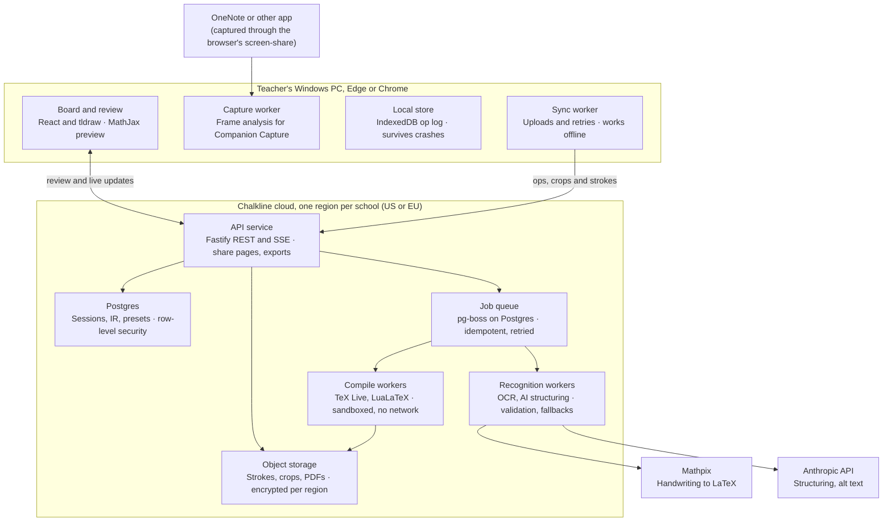
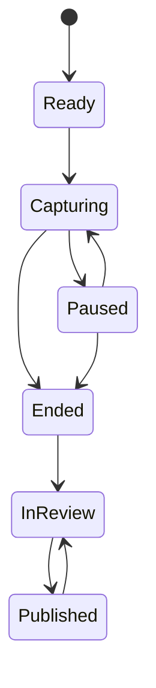

# Chalkline — Architecture Document

October 20, 2026

## Summary and principles

Chalkline is a local-first TypeScript web app: capture and frame analysis run in the teacher's browser, while recognition, structuring and LaTeX compilation run as queued jobs in a regional cloud. This document is the technical companion to `01-product-design.md`.

Seven principles decide every trade-off below:

1. **The document model is the source of truth, not LaTeX.** Recognition writes into a structured intermediate representation (IR). LaTeX, HTML and Word are renderings of it. Teacher edits are operations on the IR, so presets can change without losing edits.
2. **Local first.** Every stroke, tag and edit is written to the browser's IndexedDB before anything else happens. The network is an optimization, never a dependency during class.
3. **Frames never leave the browser.** Companion Capture uploads only crops of new writing.
4. **AI organizes, it never authors math.** The structuring model sees block ids and returns types and order. Math text comes only from the recognizer or the teacher.
5. **Always compile.** Every block is validated alone. A failing block degrades to an image, so a document never fails as a whole.
6. **Deterministic rendering.** The same IR, preset and conventions always produce byte-identical LaTeX, which makes snapshot testing and caching reliable.
7. **Every job is idempotent.** Uploads, recognition and compiles are keyed by content or client id, so retries are always safe.

## System context

Chalkline has two halves joined by one HTTPS boundary: a browser half that must never lose data, and a regional cloud half that does the heavy recognition and typesetting.



Only crops and stroke data cross from the browser to the cloud. Sign-in (WorkOS), students' share pages and export targets (Overleaf, Google Drive, OneDrive) all attach to the API service.

## Technology stack

One language (TypeScript) across client, API and workers, in one pnpm and Turborepo monorepo; the only exception is the TeX Live toolchain inside the compile container.

| Layer | Choice | Why |
| --- | --- | --- |
| Web app | React 19, Vite, TypeScript (strict), TanStack Router and Query, Zustand | Mature, fast builds, typed routing; Zustand for board and session UI state |
| UI components | Tailwind CSS with Radix UI primitives | Accessible primitives (focus, keyboard, ARIA) out of the box |
| Installable app | PWA via vite-plugin-pwa (Workbox) | Desktop install from Edge or Chrome, offline app shell, no IT install |
| Whiteboard engine | tldraw SDK, commercial license, behind a `BoardAdapter` interface | Production-grade infinite canvas, pen and pressure support, custom shapes; adapter keeps it replaceable |
| Math editing | MathLive | Visual equation editor with LaTeX in and out, touch-friendly virtual keyboard |
| Math preview | MathJax 4 | Broad LaTeX coverage, built-in accessibility (speech, MathML), runs in browser and Node |
| Local storage | IndexedDB via Dexie | Reliable large-object storage for strokes and the op log |
| Frame analysis | Dedicated Web Worker, MediaStreamTrackProcessor, OffscreenCanvas; opencv.js lazy-loaded for image alignment | Frame-driven processing off the main thread; alignment library only downloads when Companion Capture is used |
| API | Node.js 24 LTS, Fastify, Zod schemas with generated OpenAPI and typed client | Fast, schema-first, one validation layer shared with the client |
| Database | PostgreSQL 17 (Amazon RDS) with row-level security | Relational core, JSONB for the IR, tenant isolation enforced in the database |
| Jobs | pg-boss (queue on Postgres) | Jobs enqueued in the same transaction as their data; no extra broker to run |
| Live updates | Server-Sent Events | One-way server pushes are all v1 needs; simpler than WebSockets through school proxies |
| Object storage | Amazon S3 with KMS encryption, one bucket per region | Strokes, crops, assets and exports |
| Recognition | Mathpix Convert API: v3/strokes for board ink, v3/text for crops | Leading handwritten-math accuracy; stroke input is lighter and faster than images |
| Structuring AI | Anthropic API: `claude-haiku-5-5` for incremental passes, `claude-sonnet-5-5` for the final pass, figure alt text and backup recognition | Strong layout reasoning and vision; JSON output constrained by schema |
| Math parsing | unified-latex | LaTeX to AST and back, used for validation and convention transforms |
| Typesetting | TeX Live (pinned yearly release, 2025 or later), latexmk, LuaLaTeX | Required for tagged, accessible PDF with MathML |
| Word export | Pandoc, fed IR converted to Pandoc's JSON AST | Native Word equations without parsing our own LaTeX back |
| Auth | WorkOS AuthKit | Google and Microsoft sign-in, plus SAML and SCIM for districts |
| Hosting | AWS: ECS on Fargate, RDS, S3, CloudFront; infrastructure as code with AWS CDK (TypeScript) | Regional deployments in US (us-east-2) and EU (eu-central-1) |
| Observability | OpenTelemetry, Sentry, Grafana Cloud | Traces across client and workers, error tracking, dashboards |
| CI/CD | GitHub Actions, Renovate | Automated tests, compile matrix, dependency updates |

The browser target is Edge and Chrome 120 or later on Windows. The Built-in Board also works in current Firefox and Safari; Companion Capture and the floating control pill need Chromium (the pill uses Document Picture-in-Picture, available since Chrome and Edge 116).

## Client architecture

The browser does three jobs in parallel: draw ink with low latency on the main thread, analyze frames in a worker, and persist and sync everything through a local op log.

### Threads and modules

| Runs in | Module | Responsibility |
| --- | --- | --- |
| Main thread | Board (tldraw via `BoardAdapter`) | Ink, tools, pages; emits stroke-complete and erase events |
| Main thread | Session controller | Lifecycle state machine (Ready, Capturing, Paused, Ended, In review, Published), status dot, tags |
| Main thread | Review UI | Side-by-side review, MathLive editor, preset switcher, HTML preview through MathJax |
| PiP window | Control pill | Pause, Mark, Exclude last, status; a Document Picture-in-Picture window rendered by the same React app |
| Capture worker | Frame pipeline | Companion Capture analysis, crop production |
| Ink worker | Stroke grouping | Groups strokes into settled regions for recognition |
| Sync worker | Op log sync | Uploads ops, strokes and crops; receives block updates over SSE |
| Service worker | App shell | Offline load, asset caching, update control |

### Built-in Board ink path

1. The board captures pointer input with coalesced events for smooth curves and predicted events to cut perceived latency. The drawing canvas uses a low-latency (desynchronized) context where the board engine allows it.
2. On stroke end, the stroke (points with x, y, pressure and time; color; width; page) is appended to the op log in IndexedDB, then handed to the ink worker.
3. The ink worker groups strokes into a **region**. A region closes after 2 seconds without new strokes nearby, when the pen moves more than three line-heights away, or on a page change.
4. A closed region is queued for upload as stroke data. Groups larger than Mathpix's 512 KB request limit are split along line boundaries.
5. Erasures are exact events. Erasing strokes of a committed region creates a retract or correction op (rules in the Recognition section).
6. Math boxes, plots, number lines and tables bypass recognition and write IR blocks directly with confidence 1.
7. While capturing, the board holds a Screen Wake Lock so the panel never dims mid-lesson.

Implementation notes (first board slice, `apps/web` and `apps/api`):

- Strokes are stored in IndexedDB (Dexie) when the board reports them, then handed to the ink worker; board events, erasures and clock ticks go through one queue, each stamped with the time it happened. Nothing is deleted: erased strokes are marked, replaced regions keep their row. The op log, sync and session states are not built yet.
- tldraw keeps positions but not times, so a stroke's point times are spread evenly between pen down and pen up.
- Each region's ink is drawn to a PNG in the browser when it settles and used as the crop for blocks kept as images.
- Until the real API exists, a local single-user API runs recognition, structuring, probes and the handout compile inline (no database, queue or SSE). The browser keeps the session and sends recognized blocks with each handout request. `POST /v1/sessions/{id}/regions` takes the stroke data in the body and is idempotent per region id; retryable recognizer failures are not cached.

### Companion Capture frame path

1. **Acquire.** `getDisplayMedia` with a window surface preferred, audio off, the app's own tab excluded, and a 5 frames-per-second cap. The video track is transferred to the capture worker.
2. **Sample.** In the worker, a MediaStreamTrackProcessor yields frames. The pipeline keeps 2 per second and closes every other `VideoFrame` at once; an unclosed frame stalls the capture, so this is an enforced invariant.
3. **Prepare.** Apply the teacher-confirmed crop, downscale to a 960 px long side, convert to grayscale, and invert if the background is dark.
4. **Detect change.** Difference against the last stable frame, threshold, dilate. Small moving blobs (the cursor) are masked.
5. **Wait for stability.** A view is stable when frame-to-frame change stays under the threshold for 1.5 seconds.
6. **Align.** Phase correlation against the previous stable view gives scroll offset; a scale search handles zoom. Weak alignment means a page switch: the view's perceptual-hash fingerprint is matched against known pages or starts a new one.
7. **Diff against the page ink map.** Each page keeps a binary ink map in page coordinates. New ink is ink now present but absent from the map; erased ink is the reverse, within the visible area.
8. **Make regions.** New ink components are merged by proximity into regions. Each is cropped from the full-resolution frame with padding, encoded as PNG, and handed to the sync worker. Regions shaped like rectangular interface panels (menus, dialogs) are dropped as overlays.
9. **Watchdog.** No frame for 3 seconds sets the status to amber; the track's `ended` event sets it to red and offers "Resume capture".

Because processing is driven by arriving frames inside a dedicated worker, it does not depend on page timers, which browsers throttle in background tabs. A 90-minute background soak test on Edge and Chrome gates every release.

| Parameter | Default | Tuned by |
| --- | --- | --- |
| Analysis frame rate | 2 fps | Test corpus |
| Stability window | 1.5 s | Test corpus |
| Analysis resolution | 960 px long side | CPU budget on reference PC |
| Correction window (erase and rewrite) | 20 s | Pilot feedback |
| Board region settle time | 2 s | Test corpus |

### Local-first store and sync

- **Op log.** Every change (stroke, erase, tag, region, edit) is an op with a client-generated ULID and a per-session sequence number, written to IndexedDB first.
- **Sync.** The sync worker uploads ops in batches with idempotency keys, uploads blobs to presigned S3 URLs, and retries with exponential backoff. The server acknowledges the highest sequence it has stored.
- **Durability.** The app requests persistent storage at first sign-in, warns at 80% of quota, and pages stroke data out of memory for long sessions.
- **Single writer.** One device captures a session; others are read-only viewers with a "Take over" handoff that transfers the writer lease.
- **Shared computers.** In shared-computer mode, local data is deleted after a confirmed sync at session end.

### App updates during class

A new deployment never reloads the app during a capture. The service worker waits until no session is in the Capturing or Paused state, then offers the update.

## Recognition and structuring pipeline

Each settled region passes through four server stages (recognize, post-process, structure, validate) and lands in the IR as one or more blocks with a status of Ready, Check, Image or Excluded.

### Stage 1: Recognize

- **Board regions** go to Mathpix `v3/strokes` (stroke data, no image). **Crops** go to `v3/text`. Both request LaTeX and text output with line-level data and confidence.
- Requests run with Mathpix's data retention opt-out enabled.
- Jobs are keyed by region id, so a retried job never bills or writes twice.

### Stage 2: Post-process

1. Split the response into text runs and math segments.
2. Parse each math segment with unified-latex. Reject any macro outside the allowlist (see Security).
3. Repair simple faults: unbalanced braces, stray `\left` or `\right`, empty groups.
4. Assign status by confidence: at or above 0.85 is Ready, 0.6 to 0.85 is Check, below 0.6 is Image. These thresholds are tuned on the test corpus.

### Stage 3: Structure

The structuring model turns a flat list of recognized blocks into a document: types, problem and solution grouping, sections and reading order.

- **When:** an incremental pass with `claude-haiku-5-5` at most every 30 seconds during class, and a final pass with `claude-sonnet-5-5` at session end.
- **Input:** a compact list of blocks: id, kind (math or text), recognized content, page, bounding box, writing time, teacher tags, and low-resolution crops for blocks classified as figures.
- **Output:** JSON constrained by schema. It can only reference input ids; the only free text it may write is section titles and figure alt text.

```json
{
  "sections": [{ "title": "Solving quadratics", "blockIds": ["b12", "b13"] }],
  "blocks": [
    { "id": "b12", "type": "problem", "parentId": null },
    { "id": "b13", "type": "solution", "parentId": "b12" },
    { "id": "b14", "type": "announcement", "flags": ["personalName"] }
  ],
  "excluded": [{ "id": "b9", "reason": "crossedOut" }],
  "figures": [{ "id": "b20", "altText": "Parabola opening upward with vertex at (1, -4)" }]
}
```

**Guard checks** run on every response before it is applied:

- Every input id appears exactly once, either placed or excluded with a reason.
- No math content appears in the output; titles and alt text are length-limited and stripped of LaTeX.
- Teacher tags always win over the model's types.
- Blocks a teacher has edited or moved are pinned and never re-typed or reordered.

A response that fails a guard is retried once, then replaced by the **heuristic structurer**: columns and reading order from geometry, problems split at teacher tags and numbered labels ("1.", "Ex 2"), solutions as the blocks following a problem until the next one. The heuristic structurer also runs whenever the AI provider is unavailable.

### Stage 4: Validate

Each new math block is first checked by a fast parser in the worker. New blocks are then batched into a probe document and compiled with the production preamble. When the probe fails, the batch is bisected to find the failing block, which becomes an Image block with its crop attached. This is how "always compile" is guaranteed before the document is ever built.

### Commit, retract and correction rules

| Event | Rule |
| --- | --- |
| Region settles | Committed and sent for recognition |
| Committed ink erased, nothing written there within 20 s | Kept: the teacher was making room |
| Committed ink erased and new ink written in the same area within 20 s | Correction: the old block is retracted and the new region replaces it in the same position |
| Ink struck through (detected by the recognizer's line data or the model) | Excluded with reason "crossed out", visible in review |
| Teacher adds to an earlier problem | Region attaches to the nearest block above it in the same column on that page |
| Same content seen again after scroll or page return | Matched by page position and content similarity; not recognized twice |

### Fallback chain

| Failure | Behavior |
| --- | --- |
| Mathpix error or timeout | Retry with backoff for up to 10 minutes |
| Mathpix down beyond 10 minutes | Backup recognizer: `claude-sonnet-5-5` vision on the crop (board regions are rendered to an image first); results are always marked Check |
| Both recognizers unavailable | Region becomes an Image block; the teacher is told why in review |
| Anthropic API unavailable | Heuristic structurer; figure alt text left for the teacher, flagged |

### Implementation notes (v0.2)

Decisions taken while building the pipeline in `apps/worker-recognition`; they refine the sections above.

- **Two entry points.** `recognizeRegions` runs stages 1 and 2 once per region (splitting regions over the 512 KB request limit first) and returns leaf blocks to store with the region. `structureSession` takes every stored block of the session, probes the new ones, structures them and builds the document. Probing comes first, so a block that fails is already an image when it is placed.
- **Post-processing.** Mathpix Markdown is split into lines; a line holding only one math expression is display math whatever its delimiters, consecutive math lines form one derivation, and `aligned` or single-column `array` output is split into lines (the renderer re-aligns). Each region yields one or more leaf blocks with ids derived from the region id, so a retried job writes the same blocks. Status comes from `confidence_rate` (per character) rather than `confidence` (whole output exactly right, which falls with length).
- **Model input and output.** Blocks are sent as JSON data with short local ids (`b1`, `b2`, ...), kind, clipped content, page, box, time, tags and, for pinned blocks, their placement. The output lists every id once with a role (`content`, `heading`, `problem`, `part`, `solution`, `answer`, a callout kind, `figure`) and a parent, or excludes it as `crossedOut`, `projectedSource` or `interfaceText`; `personalName` is a boolean per block. Allowed parents are fixed per role, which also rules out cycles.
- **Guards, then normalization.** Hard checks (ids exactly once, known ids, allowed parents, every top-level block in one section) reject a response. Teacher decisions are then applied rather than checked: tags override roles, pinned blocks keep their placement, personal names are held back as `personalData` exclusions, a role that does not fit its block becomes content, and a parent keeps one solution and one answer. The heuristic structurer's output goes through the same steps.
- **Headings.** A heading the teacher wrote becomes its section's title and the section takes the heading block's id; the model's own titles are used only where there is no heading, as plain text of at most 80 characters.
- **Document building.** Containers take ids derived from their first block, so passes are stable. Labels the presets print themselves ("3.", "(b)", "Solution:") are stripped and "(5 points)" becomes points. Excluded blocks stay in place, marked excluded. Teacher edits to blocks, teacher-set points, titles and exclusions, and top-level blocks the teacher typed carry over to the next pass.
- **Not yet built:** the queue consumer and its retry policy, the vision backup recognizer, strike-through detection from recognizer line data, figure crops for the model (so no alt text yet), and protecting the order of blocks a teacher moved.

## Document model and LaTeX engine

The IR is a typed tree of sections and blocks with full provenance; every output format is a pure function of the IR, a preset and resolved conventions.

### The IR (packages/ir)

```ts
type Doc = {
  id: string; sessionId: string; version: number;
  meta: { title: string; course: string; teacher: string; date: string; unit?: string; lang: Lang };
  sections: Section[];
};

type Section = { id: string; title?: string; blocks: Block[] };

type Block =
  | Paragraph      // inline runs: text and inline math
  | DisplayMath    // one equation, or an aligned derivation (lines[])
  | Problem        // prompt, parts[], solution?, answer?, points?
  | Solution       // steps: Block[]
  | Callout        // definition | theorem | note | example | announcement
  | Figure         // vector ink | raster crop | exact plot spec; alt text
  | Table | List
  | ImageFallback; // crop kept because recognition or validation failed

type BlockBase = {
  id: string;                       // ULID
  status: 'ready' | 'check' | 'image' | 'excluded';
  provenance: {
    source: 'board' | 'capture' | 'import' | 'typed' | 'tool';
    regionIds: string[]; page: number; bbox: Rect; t0: number; t1: number;
  };
  recognition?: { engine: string; confidence: number; rawRef: string };
  decided: { typeBy: 'teacherTag' | 'ai' | 'heuristic' | 'teacher'; pinned: boolean };
  excludedReason?: 'crossedOut' | 'teacher' | 'personalData' | 'projectedSource';
};
```

Edits are stored as an append-only list of patch operations against the IR, each with author, time and base version. A teacher edit pins its block, so later recognition or structuring passes propose changes instead of overwriting.

### Presets (packages/presets)

A preset is a versioned, typed object, not a raw template file:

- **template:** the document class options, the preamble module list (from an allowlist) and layout settings such as columns, header and answer-space sizing.
- **structure rules:** a filter and transform over block types, for example "Practice Worksheet keeps problems, drops solutions, and reserves answer space of 1.2 times the solution's rendered height, from 3 to 12 lines."
- **conventions:** defaults for every convention in the product design document.

Conventions resolve in order: preset default, then school setting, then class setting, then preset override chosen by the teacher. A setting the school locks stops the chain.

### Rendering pipeline (packages/latex)

1. **Select.** Apply the preset's structure rules to the IR, producing a view tree.
2. **Transform math.** For each math node: parse to AST, apply convention transforms (multiplication sign, decimal comma, vector style, derivative style, upright d), then serialize. A transform only touches nodes whose role is unambiguous; ambiguous cases become review suggestions.
3. **Escape text.** All text passes one escaping function for LaTeX text mode. There is no other path from content to output.
4. **Assemble.** Typed template functions build the .tex. Every block is preceded by a `% blk:<id>` comment, and a source map records each block's line range.
5. **Assets.** Vector board figures render to SVG and then PDF; raster crops are cleaned (background whitened, contrast normalized); exact plots compile separately as standalone figures, cached by a hash of their spec.

The output is deterministic: no timestamps, random ids or ordering by hash inside the .tex. Snapshot tests depend on it.

### Accessibility and package policy

- Every document starts with `\DocumentMetadata` turning tagging on with PDF/UA-2 and MathML structure elements, compiled with LuaLaTeX.
- Every package in a preamble module must be listed as compatible on the LaTeX Tagging Project's status page for the pinned TeX Live release. CI runs `check-tagging-status` and veraPDF's UA-2 profile on every preset.
- Known breakers are banned outright; titlesec is the first entry on the ban list.
- Plots compile separately because tagging slows pgfplots considerably; each plot PDF is included with its alt text.
- A custom preamble from an advanced user may use only allowlisted packages and is test-compiled before saving. If it is not tagging-compatible, the PDF is published untagged with the accessible HTML link alongside, and the teacher is told.

### Overflow handling

After compiling, the log's "Overfull \hbox" warnings are mapped back to blocks through the source map. Display math wider than the text block is first broken at relation signs into an aligned environment; if that fails, it is scaled to the text width with a minimum of 80% and flagged in review.

### Other renderers

- **HTML (packages/html):** the same view tree rendered for the in-app preview and share pages, with MathJax 4. It is a preview of, and never a substitute for, the PDF.
- **Word:** the view tree converted to Pandoc's JSON format, then to .docx by Pandoc, so equations become native Word equations.

### Implementation notes (v0.1)

Decisions taken while building the Foundations slice; they refine the sections above.

- **Select step.** `selectView()` in `packages/ir` applies a preset's structure rules and produces the view tree every renderer consumes. Problem numbering is computed there, so a worksheet and its key always agree.
- **Renderer contract.** The LaTeX renderer emits a fixed vocabulary of commands and environments (`\cltitle`, `clproblem`, `cldefinition`, `\clanswerboxed`, ...; see `CONTRACT` in `packages/latex/src/render/template.ts`). Preset preamble modules define them, so presets control the look without the renderer knowing about it. Callouts use `xparse` environments and simple `tcolorbox` boxes, not amsthm.
- **Languages.** babel is not loaded: its tagging status is unchecked as a whole and French is currently incompatible. Labels and dates are localized by the renderer, the PDF language comes from `\DocumentMetadata`, and non-English documents switch hyphenation off rather than hyphenate with English patterns.
- **Glyph coverage.** Text fonts fall back to the matching math font and then FreeSerif/FreeSans (luaotfload fallback), so Greek, arrows, relations and Cyrillic in text never print as nothing (a missing glyph also fails PDF/UA-2). Characters outside the covered ranges are reported as `unsupportedCharacter` render issues for review.
- **Sanitizer.** Built on unified-latex's parser, but serialization is our own walk over the AST: the same pass validates and emits, so nothing reaches the output unchecked. Beyond the allowlist it rejects structures TeX would fail on (double scripts, unbalanced `\left`/`\right`, `&` or `\\` outside alignment environments, `\limits` after a non-operator) and enforces size and depth limits.
- **Compile matrix.** Besides every preset × fixture × key conventions, it compiles one document exercising every allowlisted command and environment and one with hundreds of random sanitizer outputs, all in the bubblewrap sandbox, then validates each PDF with veraPDF's PDF/UA-2 profile.

## Compile and export service

Compilation runs in a warm pool of sandboxed containers with no network, a read-only file system and a 60-second limit per job, and results are cached by content hash.

### Job flow

1. The API renders the .tex and asset list from the IR, stores the bundle in S3 and enqueues a compile job keyed by `sha256(tex + assets + TeX Live version)`.
2. If a PDF already exists for that key, it is returned at once.
3. A compile worker downloads the bundle into a fresh temporary directory and runs `latexmk -lualatex` inside a bubblewrap sandbox with no network namespace.
4. It uploads the PDF, the log and the parsed warnings (overfull boxes mapped to block ids), then deletes the working directory.
5. Overflow warnings trigger one automatic re-render with the fixes from the Overflow section, then a final compile.

### Sandbox settings

| Control | Setting |
| --- | --- |
| Shell escape | Disabled (`-no-shell-escape`, `shell_escape = f`) |
| File access | `openin_any = p` and `openout_any = p`: TeX reads and writes only inside the job directory |
| Network | None: task without egress, plus a sandbox with no network namespace |
| File system | Read-only root, tmpfs working directory, wiped after every job |
| Resources | 2 vCPU, 4 GB memory, 60 s wall clock, 50 MB output cap |
| Input | Only LaTeX generated by the engine from sanitized IR, plus allowlisted preamble modules |

### Pool and performance

- Workers are long-running Fargate tasks that process jobs one at a time; a cold container per job would add tens of seconds.
- The pool autoscales on queue depth. School-day peaks are predictable, so a scheduled minimum is raised during school hours in each region's time zones.
- Target: p95 under 15 seconds for a 10-page document, excluding cached plots.

### Exports

| Export | How it is produced |
| --- | --- |
| PDF | Compile service; tagged PDF/UA-2 unless the preset opts out |
| .tex | The rendered source, with a header comment naming the preset, TeX Live version and compile command |
| Project .zip | .tex, assets, a README with the compile command, and a `latexmkrc` |
| Open in Overleaf | A short-lived signed URL to the .zip, posted to Overleaf's open-project endpoint with LuaLaTeX selected |
| Word | Pandoc from the view tree's Pandoc JSON |
| Share page | Server-rendered HTML from packages/html with MathJax 4 and a PDF download |
| Google Drive, OneDrive | Uploaded by the API through each provider's API after the teacher connects the account (least-privilege, file-scoped access) |

Every export records the document version it came from. A share link always serves the latest published version.

## Data model and storage

Postgres holds everything relational and the current IR; S3 holds bulk data (strokes, crops, assets, exports); every row and object belongs to exactly one workspace in exactly one region.

### Core tables

| Table | Key columns | Notes |
| --- | --- | --- |
| workspace | id, name, region, plan, settings, locked_conventions | A school or an individual teacher; region fixed at creation |
| user | id, workspace_id, email, role, locale, time_zone | Roles: teacher, admin |
| class | id, workspace_id, owner_id, name, default_preset_id, bell_schedule | |
| session | id, class_id, owner_id, mode, state, writer_device_id, writer_lease_until, started_at, ended_at, lesson_title, continues_session_id | State machine enforced in the API |
| page | id, session_id, index, background_asset_id, fingerprint | Fingerprint used for page matching in Companion Capture |
| op | session_id, seq, op_id (ULID), kind, payload, device_id, created_at | Append-only; unique on op_id for idempotency |
| region | id, session_id, page_id, source, bbox, t0, t1, asset_key, status | One per settled region |
| recognition | region_id, engine, confidence, raw_key, cost_micros | Raw provider response kept in S3 for 30 days for debugging |
| document | id, session_id, version, ir (jsonb), published_version | Current IR; history in document_patch |
| document_patch | document_id, version, patch (jsonb), actor, created_at | Restores and audit |
| preset | id, workspace_id (null for built-in), owner_id, base_preset_id, version, config (jsonb), locked | |
| export | id, document_id, document_version, kind, cache_key, asset_key, status | |
| share_link | id, document_id, token_hash, expires_at, revoked_at | Token is 128 bits of randomness, stored hashed |
| usage_ledger | workspace_id, session_id, provider, units, cost_micros, at | Cost per class hour and quotas |
| audit_event | workspace_id, actor, action, target, at | Admin-visible log |

Every table with workspace data carries `workspace_id`, and row-level security policies restrict every query to the workspace in the request's database session. The API sets that per transaction; workers use a dedicated role that must set it explicitly.

### Object storage layout

`s3://chalkline-<region>/<workspace_id>/<session_id>/` holds:

- `strokes/<page_id>/<chunk>.bin`: compressed stroke chunks
- `regions/<region_id>.png`: crops, deleted 24 hours after recognition unless pinned as a figure or image fallback
- `assets/`: figures, backgrounds, plot PDFs
- `exports/<document_version>/`: PDF, .tex, .zip, .docx

### Retention

| Data | Default retention |
| --- | --- |
| Screen frames | Never stored (browser memory only) |
| Crops not used as figures | 24 hours after recognition |
| Raw recognizer responses | 30 days |
| Strokes, IR, exports | Until the teacher deletes the session, or the school's retention period ends |
| Deleted data in backups | Purged within 30 days |

Deleting a session removes its rows, objects and share links at once and queues backup purges. Workspace deletion does the same for everything and issues a deletion certificate to the admin.

## Backend services and API

Three deployable services share one codebase and one database: the API, the recognition workers and the compile workers.

| Service | Scales on | Does |
| --- | --- | --- |
| api | Request rate | REST API, SSE live events, share pages, auth callbacks, IR rendering, export orchestration |
| worker-recognition | Queue depth of recognize and structure jobs | Mathpix and Anthropic calls, post-processing, structuring guards, validation probes |
| worker-compile | Queue depth of compile jobs | Sandboxed LuaLaTeX, Pandoc, SVG to PDF, image cleanup |

### API conventions

- REST under `/v1`, JSON, Zod-validated; the OpenAPI spec and typed client are generated from the same schemas.
- Every mutation accepts an `Idempotency-Key` header; ops and regions also carry client ULIDs.
- Document writes use optimistic concurrency: `If-Match` with the document version, `409` on conflict with the current version in the body.
- Errors use RFC 9457 problem details with stable `type` codes the client maps to teacher-facing messages.
- App auth is an httpOnly, SameSite=Lax session cookie from WorkOS; share pages use their own token and never the cookie.

### Endpoints

| Method and path | Purpose |
| --- | --- |
| `POST /v1/sessions` | Start a session (class, mode, preset); returns the writer lease |
| `POST /v1/sessions/{id}/ops` | Upload a batch of ops; returns the highest stored sequence |
| `POST /v1/sessions/{id}/regions` | Register a settled region; returns a presigned upload URL for its crop or stroke data |
| `POST /v1/sessions/{id}/state` | Pause, resume, end, take over |
| `GET /v1/sessions/{id}/events` | SSE stream: block updates, status, lease changes |
| `GET /v1/documents/{id}` | Current IR with block statuses |
| `PATCH /v1/documents/{id}` | Apply teacher edit patches (If-Match) |
| `POST /v1/documents/{id}/render` | Render with a preset; returns HTML preview and a compile job id |
| `POST /v1/documents/{id}/publish` | Publish a version; creates or updates the share link |
| `POST /v1/documents/{id}/exports` | Request an export (pdf, tex, zip, docx, overleaf, drive, onedrive) |
| `GET /v1/exports/{id}` | Export status and download URL |
| `GET, POST, PATCH /v1/presets` | List, clone and edit presets; edits are test-compiled |
| `GET, POST /v1/classes` | Classes and their defaults |
| `GET /v1/admin/audit`, `PATCH /v1/admin/settings` | Admin log and school settings |
| `GET /s/{token}` | Public share page (no account) |

### Session state machine

State changes go through one function in the API that checks the transition and the writer lease, writes the change and its audit event in one transaction, and publishes it to SSE. Allowed transitions: Ready to Capturing; Capturing and Paused to each other; either to Ended; Ended to In review; In review to Published; Published back to In review. The writer lease is 60 seconds, renewed by the capturing device's heartbeat, and is transferred only by an explicit take-over.



## Security model

The threats specific to Chalkline are content-driven: recognized board text reaching LaTeX, HTML or an AI prompt. Each path has a dedicated control, on top of standard SaaS hardening.

| Threat | Control |
| --- | --- |
| LaTeX injection (`\write18`, `\input{/etc/passwd}`, `\directlua`, catcode tricks) | Math is parsed to an AST and re-serialized; macros outside a strict allowlist are rejected, including `\input`, `\include`, `\write`, `\openin`, `\openout`, `\read`, `\csname`, `\catcode`, `\def`, `\let`, `\directlua`, `\usepackage`. Text goes through one escaping function. The compile sandbox is the second line of defense |
| Cross-site scripting through recognized content | Content is never inserted as HTML; React text nodes only. MathJax runs with its safe extension; any rich HTML passes DOMPurify. Strict Content Security Policy with nonces, no inline scripts |
| Prompt injection through board content ("ignore previous instructions") | Board content is passed to the model as data inside a schema; the model has no tools and can only return ids, types, titles and alt text; guard checks reject anything else |
| Cross-tenant access | Postgres row-level security on every workspace table; S3 keys prefixed by workspace and checked on presign; tests that try every endpoint with another workspace's ids |
| Share link guessing or leakage | 128-bit random tokens stored hashed, rate-limited lookups, revocation and expiry, `noindex` and `Referrer-Policy: no-referrer` |
| Over-collection during screen capture | Window-only capture, teacher-confirmed crop, frames kept in worker memory only, crops deleted after recognition |
| Session hijacking | httpOnly SameSite cookies, short sessions with refresh, re-authentication for admin actions, SSO enforced by school policy |
| Supply chain | Lockfile, Renovate with review, npm provenance checks, SBOM per release, pinned container digests and TeX Live release |
| Secrets | AWS Secrets Manager; no provider keys in the browser. Mathpix and Anthropic are called only from workers |
| Abuse of public share pages | Per-token and per-IP rate limits behind CloudFront; files served from a separate cookieless domain |

Logs and traces carry ids, never content: no recognized text, LaTeX or image data. Support can view a teacher's content only with that teacher's time-limited, logged consent.

## Reliability, offline behavior and performance

The one failure Chalkline must never have is losing a lesson; everything else degrades gracefully in a fixed order: live view, then structuring quality, then recognition, then nothing during class.

### Degradation ladder

| What is unavailable | What the teacher experiences |
| --- | --- |
| Network | Capture continues; status dot amber; everything syncs on reconnect |
| Anthropic API | Heuristic structuring; slightly rougher organization; alt text flagged |
| Mathpix | Backup recognizer after 10 minutes; more blocks marked Check |
| Both recognizers | Image blocks with an explanation; recognition can be re-run later from review |
| Compile service | HTML preview and .tex export still work; PDF arrives when the service recovers |
| Chalkline API | Capture and local review continue; publishing waits |

### Durability rules

- An op is written to IndexedDB before it affects the UI. A crash at any point loses at most the stroke being drawn.
- The server acknowledges by sequence number; the client deletes nothing locally until it is acknowledged and the session has ended.
- If the writer lease expired while a device was offline and nobody took over, the device silently renews it on reconnect. If someone did take over, the returning device uploads its pending ops (they are idempotent) and becomes a viewer.
- Recognize, structure and compile jobs are idempotent and retried with backoff; poison jobs go to a dead-letter queue that pages on-call.
- Postgres runs Multi-AZ with point-in-time recovery; S3 versioning protects against accidental overwrite.

### Service objectives

| Objective | Target |
| --- | --- |
| API availability during school hours | 99.9% |
| Settle to block visible in live view | p95 under 8 s |
| End class to document ready (60-minute lesson) | p95 under 60 s |
| Compile, 10-page document | p95 under 15 s |
| Sessions with lost content | 0 |

### Client performance budgets

The reference machine is a typical classroom PC: a 4-core laptop-class CPU, 8 GB of memory, integrated graphics, driving a 4K panel over HDMI.

| Budget | Target |
| --- | --- |
| Ink latency, pen move to pixel | p95 under 25 ms |
| Capture worker CPU | Under 15% of one core at 2 fps |
| Memory during a 3-hour session | Flat: under 600 MB for the tab |
| First load on school Wi-Fi | Largest Contentful Paint under 2.5 s |
| Board route JavaScript | Under 900 KB gzipped; opencv.js loads only for Companion Capture |
| Return visit | App shell from the service worker, interactive in under 1 s |

## Testing, observability and quality gates

The recorded-lesson corpus is the most valuable test asset: every recognition, capture or structuring change is measured against it before merge.

### The lesson corpus

- **Contents at launch:** at least 150 recorded lessons. Board lessons are stroke logs with timing; Companion Capture lessons are screen recordings of OneNote, Microsoft Whiteboard and panel software at several zoom levels, in light and dark themes, including scrolling, page switches, menus and erasing.
- **Ground truth:** a hand-checked IR for each lesson.
- **Replay harness:** runs the full pipeline headless (capture algorithms in Node on recorded frames, recognizer responses either live or replayed from cache) and scores block-level edit distance, missed blocks, duplicates, wrong types and wrong order.
- **Consent:** recordings come from teachers who agreed in writing; no student faces or voices.

### Test layers

| Layer | Tooling | Covers |
| --- | --- | --- |
| Unit | Vitest | Pure functions in ir, latex, conventions, capture, ink |
| Property-based | fast-check | Text escaping, math sanitizer and convention transforms: random input never produces uncompilable or unsafe output |
| Snapshot | Vitest | Byte-exact .tex per preset and fixture |
| Compile matrix | CI with the production compile image | Every preset × every fixture × key convention combinations compiles; veraPDF UA-2 check on tagged output |
| Integration | Testcontainers (Postgres, MinIO) | API, queue, workers, row-level security with cross-tenant attack tests |
| End to end | Playwright on Edge and Chrome | Board drawing with synthetic pen and touch input, a fake display-capture stream for Companion Capture, offline and reconnect, review and publish |
| Soak | Nightly on Windows VMs | 90 minutes of Companion Capture with the tab in the background; 3-hour board session memory check |
| Accessibility | axe in Playwright, manual audits with NVDA and JAWS | WCAG 2.1 AA for the app; tagged PDF and share page with screen readers |
| Load | k6 | 8 a.m. Monday peak: many simultaneous session starts and end-of-class finalizations |

### Merge and release gates

- Merge: unit, snapshot, integration and compile matrix green; no drop of more than 0.5 points in corpus scores.
- Release: end-to-end and soak tests green; accessibility checks pass; corpus targets met (95% board, 85% Companion Capture).

### Observability

- **Tracing:** OpenTelemetry from the browser through the API to workers, keyed by session and region ids.
- **Dashboards:** settle-to-block latency, confidence distribution, fallback rate per stage, image-fallback rate, structuring guard failures, compile duration and failures, cost per class hour.
- **Alerts:** any compile failure on generated LaTeX pages on-call (it means the validator missed something). So do a rising image-fallback rate, provider error spikes and a growing dead-letter queue.
- **Product analytics:** event counts only (sessions, presets used, review edits by type), never content.

## Deployment, environments and cost

Four environments, two production regions, and a variable cost target under $0.40 per class hour driven mostly by recognition calls.

### Environments

| Environment | Purpose | Notes |
| --- | --- | --- |
| Local | Development | Docker Compose: Postgres, MinIO for S3, the compile image, workers with recorded provider responses so no API keys are needed |
| Preview | Per pull request | Ephemeral stack with seeded data; recorded providers by default |
| Staging | Release candidate | Mirrors production; live providers on test keys; soak and load tests run here |
| Production | US (us-east-2) and EU (eu-central-1) | Separate stacks and data; the workspace's region decides the API host at sign-in |

### Release process

- Web assets deploy to S3 and CloudFront with content-hashed file names; old assets stay available for 7 days so open sessions never break.
- Services deploy as rolling ECS updates behind health checks; workers drain their current job before stopping.
- Database migrations follow expand-then-contract: additive first, code switch, removal in a later release.
- Feature flags live in Postgres and are delivered with the session config, so a flag never changes mid-lesson.
- The TeX Live image is upgraded once a year after the full compile matrix and veraPDF checks pass on the new release.

### Variable cost per class hour (estimate)

| Item | Assumption | Estimate |
| --- | --- | --- |
| Recognition, Built-in Board | About 80 settled regions an hour on `v3/strokes` at $0.002 each | $0.16 |
| Recognition, Companion Capture | About 100 crops an hour on `v3/text` at $0.002 each | $0.20 |
| Structuring and alt text | Haiku incremental passes plus one Sonnet final pass | Measure in Foundations phase; budget $0.10 |
| Compile and storage | A few compiles of a few seconds each; small objects | Under $0.02 |
| **Total** | | **Under $0.40 target** |

Mathpix volume pricing drops above 1 million requests a month, and live stroke sessions (unused in v1) are billed differently from plain stroke requests. Region counts and AI token use are measured during the pilot and the budget is re-set before launch.

## Sources

- [Mathpix Convert API pricing](https://mathpix.com/pricing/api) and [v3/strokes reference](https://docs.mathpix.com/reference/post-v3-strokes)
- [tldraw: license key](https://tldraw.dev/sdk-features/license-key)
- [Chrome Developers: Document Picture-in-Picture](https://developer.chrome.com/docs/web-platform/document-picture-in-picture) and [background tab throttling](https://developer.chrome.com/blog/background_tabs)
- [Overleaf: creating accessible PDFs](https://docs.overleaf.com/writing-and-editing/creating-accessible-pdfs) and [TUG: the LaTeX Tagging Project](https://tug.org/mactex/taggingproject.html)
- [Purdue: notes on PDF accessibility with LaTeX](https://www.math.purdue.edu/~yipn/TPC/prescott-PDFAccessibility-2025-11.pdf) (pgfplots slowdown with tagging)
- [MathJax v4.0.0 release](https://github.com/mathjax/MathJax/releases)
